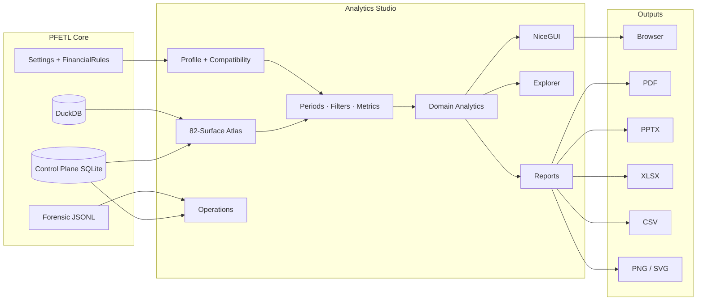

<p align="center">
  
</p>

# PFETL Analytics Studio

<p align="center">
  <strong>Local-first analytical intelligence for the financial truth produced by Personal Finance ETL.</strong>
</p>

<p align="center">
  <em>PFETL Core decides what is true. Analytics Studio makes that truth explorable.</em>
</p>

<p align="center">
  <a href="https://pypi.org/project/pfetl-analytics-studio/"></a>
  
  <a href="https://www.gnu.org/licenses/gpl-3.0"></a>
  
  
  
  
</p>

---

## Contents

- [Why Studio exists](#why-studio-exists)
- [PFETL product family](#pfetl-product-family)
- [Architecture](#architecture)
- [Core invariants](#core-invariants)
- [Nine analytical workspaces](#nine-analytical-workspaces)
- [82-surface analytical atlas](#82-surface-analytical-atlas)
- [Semantic analytics](#semantic-analytics)
- [Visualization system](#visualization-system)
- [Reporting engine](#reporting-engine)
- [Operational intelligence](#operational-intelligence)
- [Read-only safety and provenance](#read-only-safety-and-provenance)
- [Performance architecture](#performance-architecture)
- [Standalone desktop experience](#standalone-desktop-experience)
- [Installation and launch](#installation-and-launch)
- [Exports](#exports)
- [Testing and quality](#testing-and-quality)
- [Technology stack](#technology-stack)
- [Repository architecture](#repository-architecture)
- [What this project demonstrates](#what-this-project-demonstrates)
- [Relationship with PFETL Core](#relationship-with-pfetl-core)
- [Project maturity](#project-maturity)
- [Author](#author)
- [License](#license)

---

# Why Studio exists

Personal Finance ETL already solves the hardest problem in the system:

> **deciding what the evidence means and reconstructing canonical financial truth.**

Analytics Studio starts where that job ends.

It is the local-first, read-only analytical companion to [Personal Finance ETL](https://github.com/tks18/personal-finance-etl), built for exploration, comparison, visualization, drill-down, operational diagnosis, and presentation-grade reporting.

It answers questions such as:

- Why did net worth change?
- Is expense growth inflation or lifestyle change?
- How resilient is income?
- Where is portfolio concentration accumulating?
- Is return coming from the asset or FX?
- What is the current indicative tax exposure?
- Which lots are approaching LTCG maturity?
- How is the FIRE trajectory changing?
- Which PFETL run, source, provider call, or failure explains the current state?
- Can the same analysis become a PDF, PPTX, XLSX, CSV, PNG, or SVG without rebuilding logic elsewhere?

Studio is not another ETL pipeline and not another accounting engine.

It is the analytical control room for PFETL.

---

# PFETL product family

```text
PFETL
├── Core
│   ├── ingest evidence
│   ├── reconstruct financial state
│   ├── calculate canonical methodology
│   ├── reconcile
│   ├── preserve provenance
│   ├── recover
│   └── publish analytical truth
│
└── Analytics Studio
    ├── explore
    ├── compare
    ├── visualize
    ├── drill
    ├── diagnose
    ├── report
    └── export
```

The ownership rule is simple:

> **Core owns truth. Studio owns interpretation and presentation.**

Studio does not reimplement:

- FIFO;
- realized gain methodology;
- tax classification;
- reconciliation;
- XIRR;
- FX attribution;
- FIRE methodology;
- Monte Carlo simulation.

Core metrics stay Core metrics. Studio-derived comparisons, shares, and presentation statistics remain explicitly Studio-owned.

---

# Architecture



Studio consumes five upstream inputs:

```text
DuckDB
→ canonical financial and analytical state

Control Plane SQLite
→ runs, evidence, providers, failures, provenance

Settings TOML
→ operational context

FinancialRules TOML
→ financial-policy context

Forensic JSONL
→ execution lineage
```

There is no second financial configuration universe.

---

# Core invariants

1. **Read financial truth, do not recreate it.**
2. **Keep PFETL upstream stores read-only.**
3. **Bind to loopback by default.**
4. **Keep historical provenance truthful.**
5. **Treat metric and period semantics as code.**
6. **Run heavy I/O outside the NiceGUI event loop.**
7. **Lazy-load expensive workspaces.**
8. **Stream large exports instead of multiplying them in memory.**
9. **Keep Studio state separate from PFETL state.**
10. **Prefer inspectable evidence over black-box dashboards.**

---

# Nine analytical workspaces

| Workspace | Purpose |
|---|---|
| **Overview** | Whole-system cockpit |
| **Household** | Income, expense, budget, cashflow, transactions |
| **Wealth** | Net worth, liquidity, asset structure, attribution |
| **Investments** | Allocation, performance, lots, reconciliation, evidence |
| **Tax** | FY position, breakdown, events, harvesting |
| **FIRE** | FI targets, simulations, runway, scenarios |
| **Operations** | Runs, sources, providers, failures, forensics |
| **Explorer** | Catalog, guided analytics, saved views, read-only SQL |
| **Reports** | 15 built-ins, custom reports, multi-format export |

---

## Overview

Overview answers:

> **What is happening across the complete financial system right now?**

It combines high-level signals across Household, Wealth, Investments, Tax, FIRE, and PFETL operations.

Typical measures:

- market and book net worth;
- income and expense;
- net cashflow and savings rate;
- investment flow;
- portfolio value and XIRR;
- benchmark return;
- indicative tax exposure;
- FI coverage;
- concentration;
- liquidity runway;
- passive-income coverage;
- active-income dependency;
- latest PFETL run health.

Typical visuals:

- net-worth trajectory and attribution;
- cashflow efficiency;
- capital deployment;
- portfolio performance;
- income / expense composition;
- asset-class mix;
- FIRE trajectory.

Overview is intentionally a cockpit, not a substitute for domain pages.

---

## Household

Four lazy-loaded areas:

```text
Income
Expense
Budget & Cashflow
Transactions
```

### Income

- active / passive income;
- cash / non-cash;
- dividends and interest;
- YTD accumulation;
- income resilience;
- source concentration;
- receiving-account mix;
- taxability composition;
- passive-income coverage;
- transaction drill-down.

### Expense

- core / non-core;
- cash / non-cash;
- real vs nominal spend;
- lifestyle growth;
- inflation-adjusted spending;
- category concentration;
- hierarchical composition;
- month/category heatmaps;
- transaction drill-down.

### Budget & Cashflow

- target vs actual budget;
- monthly budget health;
- operating / investing / financing cashflow;
- runway;
- waterfall analysis;
- reconciliation;
- transfer drill-down.

### Transactions

- unified income / expense / transfer ledger;
- server-side filtering;
- pagination;
- Silver-field inspection;
- linked-transfer context;
- streaming full CSV export.

---

## Wealth

Wealth focuses on the balance sheet and the reasons it changes.

Capabilities include:

- market and book net worth;
- opening vs closing wealth;
- net-worth attribution;
- liquid vs illiquid assets;
- debt and liquidity;
- asset-group composition;
- asset detail;
- asset P&L vs FX P&L;
- drawdown;
- currency and foreign exposure;
- savings vs market contribution.

The core question:

> **Did wealth grow because I saved, because markets moved, because FX moved, or because of something else?**

---

## Investments

Five lazy-loaded workspaces:

```text
Overview & Allocation
Performance & Benchmarks
Lot Explorer
Realized & Reconciliation
Market Evidence
```

### Overview & Allocation

- value and cost basis;
- allocation by class / type / subtype / sector / industry / geography / country / currency / ISIN;
- target drift;
- top holdings;
- gainers / losers;
- concentration;
- P&L decomposition;
- harvesting exposure.

### Performance & Benchmarks

- XIRR;
- benchmark XIRR;
- active return;
- CAGR;
- drawdown;
- asset vs FX P&L;
- FX contribution;
- segment alpha;
- concentration trends;
- risk / return analysis.

### Lot Explorer

- open lots;
- quantity and cost basis;
- current value;
- holding classification;
- unrealized gain/loss;
- tax-if-sold context;
- days to LTCG;
- pre-tax vs after-tax;
- harvesting context;
- chunked full export.

Studio consumes canonical PFETL lot state. It never recalculates FIFO.

### Realized & Reconciliation

- FY realized P&L;
- asset vs FX realized P&L;
- tax drag;
- tax-type mix;
- quantity bridge;
- reconciliation adjustments;
- event lineage.

### Market Evidence

- prices;
- portfolio value history;
- benchmark history;
- FX history;
- normalized indices;
- provider/provenance context.

---

## Tax

Four areas:

```text
FY Overview & Exposure
Income Head Breakdown
Reconciliation & Audit
Tax Events & Harvesting
```

Capabilities include:

- multi-FY tax position;
- indicative exposure;
- head and sub-head composition;
- source classification;
- taxable / non-taxable / unclassified visibility;
- ledger vs quantitative reconciliation;
- event timelines;
- FY readiness;
- holding period;
- LTCG maturity;
- harvesting exposure.

Tax is analytical evidence and planning support, not statutory filing software.

---

## FIRE

Three areas:

```text
FI Trajectory & Targets
Runway, Savings & Velocity
Simulation Provenance & Rules
```

Capabilities include:

- FI corpus targets;
- FI coverage;
- Lean FI and Coast FI;
- target-age analysis;
- savings gaps;
- required savings rates;
- wealth velocity;
- emergency runway;
- Monte Carlo probability;
- P10 / P50 / P90 bands;
- terminal values;
- simulation provenance;
- FinancialRules context.

A separate what-if sandbox provides Studio-side sensitivity analysis while remaining visually distinct from canonical PFETL outputs.

---

## Operations

Four areas:

```text
Runs & Sync Health
Sources & Artifacts
Providers & Failures
Forensics & Evidence
```

### Runs & Sync Health

- run history;
- duration;
- execution and commit state;
- sync outcomes;
- Core version history;
- warehouse contract health;
- row counts.

### Sources & Artifacts

- source registry;
- artifact events;
- source freshness;
- retained payloads;
- convergence history.

Large retained SQLite payloads can stream directly to temporary files without full BLOB materialization.

### Providers & Failures

- external requests;
- retries;
- cache state;
- provider outcomes;
- failure domains;
- run failures.

### Forensics & Evidence

- severity and stage distributions;
- worker activity;
- slow operations;
- operation lineage;
- execution timeline;
- historical run context;
- Settings diff;
- FinancialRules diff;
- structured JSONL inspection.

---

## Explorer

Four lazy-loaded tools:

```text
Data Catalog
Guided Analytics
Saved Views
Advanced SQL
```

### Data Catalog

Explore all 82 classified PFETL surfaces with metadata including:

- layer;
- domain;
- grain;
- usage;
- columns;
- row count;
- compatibility;
- analytical role.

### Guided Analytics

Guided Analytics uses typed dataset and metric semantics.

It knows:

- additivity;
- valid aggregation;
- valid dimensions;
- valid filters;
- period semantics;
- metric origin.

This prevents invalid operations such as summing XIRR unless explicitly supported.

### Saved Views

Saved analytical definitions live in Studio's own SQLite and can be reused by Explorer and custom reports.

### Advanced SQL

Read-only SQL permits `SELECT` and `WITH ... SELECT` patterns while rejecting write-capable or environment-mutating statements.

---

## Reports

Reports provides:

- 15 built-in reports;
- custom reports;
- cloning;
- block reordering;
- Saved View blocks;
- historical run selection;
- provenance comparison;
- multi-format export.

### 15 built-in reports

**Financial & wealth**
1. Monthly Financial Review
2. Financial Year Review
3. Net Worth & Wealth Attribution

**Household & cashflow**
4. Cashflow & Budget Review
5. Expense & Lifestyle Review
6. Income Resilience Review

**Portfolio & markets**
7. Portfolio Review
8. Investment Performance & Benchmark
9. Multi-Currency Exposure Review

**Tax & FIRE**
10. Investment Tax & Harvesting
11. Tax Position Review
12. FIRE & Planning Review

**Operations & evidence**
13. Data Health & PFETL Operations
14. Run Forensic Report
15. Source Evidence & Change Report

### Custom report editor

Supported block concepts include:

- title;
- subtitle;
- narrative;
- KPI;
- chart;
- table;
- Saved View;
- provenance;
- divider;
- page break.

Built-in and custom reports share the same typed runtime.

---

# 82-surface analytical atlas

Studio explicitly classifies the PFETL analytical universe:

```text
Bronze         20
Silver         24
Gold           22
Meta            6
Control Plane  10
─────────────────
Total          82
```

The atlas acts as a compatibility gate between Core and Studio.

If PFETL evolves beyond the structure Studio understands, Studio can report incompatibility rather than silently produce misleading analytics.

---

# Semantic analytics

## Periods

The period resolver supports concepts including:

- Latest Month;
- Selected Month;
- Calendar Quarter;
- FY Quarter;
- YTD;
- FYTD;
- Financial Year;
- Rolling 3 / 6 / 12 / 24 Months;
- Since Inception;
- Custom Range.

Period semantics come from PFETL calendar data rather than independent guesses.

## Metrics

Metric specifications can encode:

```text
grain
additivity
aggregation
allowed dimensions
format
origin
```

Origin distinguishes:

```text
CORE
→ canonical PFETL metric

STUDIO_DERIVED
→ presentation statistic derived from canonical data
```

That boundary prevents a visualization layer from quietly becoming a second financial engine.

---

# Visualization system

Studio contains more than **100 purpose-built Plotly visualization builders** across its financial and operational domains.

The visual grammar includes:

- line and area;
- grouped / stacked / horizontal / diverging bars;
- waterfall;
- treemap;
- heatmap;
- scatter / bubble;
- donut;
- dual-axis comparisons;
- percentile bands;
- reference lines;
- normalized indices.

Chart type follows analytical meaning:

```text
state over time       → line
period flow           → bars
positive / negative   → diverging bars
attribution           → waterfall
hierarchy             → treemap
pattern density       → heatmap
uncertainty           → percentile band
```

The shared chart layer also separates compact cockpit interaction from deeper analytical interaction.

---

# Reporting engine

Reports are rendered through a typed runtime rather than browser screenshots.

```text
ReportDefinition
        ↓
ReportContext
        ↓
Block Sources
        ↓
Rendered Blocks
        ↓
Exporter
```

Report context can preserve:

- PFETL run;
- period;
- filters;
- Settings provenance;
- FinancialRules provenance;
- PFETL version.

This makes artifacts deterministic and auditable.

---

# Operational intelligence

Studio treats operational truth as a first-class analytical domain.

A financial result becomes easier to trust when the system can answer:

```text
Which run produced it?
Which source evidence was involved?
Which Settings were active?
Which FinancialRules were active?
Which provider calls occurred?
Which failures occurred?
What did the forensic lineage show?
```

Studio therefore explains not only:

```text
financial state
```

but also:

```text
how that state was produced.
```

---

# Read-only safety and provenance

## DuckDB

Opened read-only. Studio does not publish tables back into PFETL.

## Control Plane

Consumed read-only for runs, snapshots, artifacts, providers, failures, simulations, and retained evidence.

## Settings and FinancialRules

Read from the same TOML files as Core. Studio does not create a second policy store.

## Studio-owned state

Writable Studio state includes:

- recent profiles;
- preferences;
- Saved Views;
- custom reports;
- report history;
- runtime metadata;
- temporary exports.

These live under user-owned `platformdirs` locations.

## Historical provenance

Studio distinguishes:

```text
analytical_run_id
```

from:

```text
historical_inspection_run_id
```

so current warehouse analytics cannot masquerade as an older analytical state.

Historical Settings/FinancialRules snapshots can be inspected through the Control Plane.

---

# Performance architecture

## I/O stays off the event loop

Heavy database/file work runs through NiceGUI's I/O-bound worker boundary.

## Heavy workspaces are lazy

Household, Investments, Tax, Operations, and Explorer do not query unopened tabs.

## Stale-result protection

Older background results cannot overwrite newer filter/period state.

## Short-lived read sessions

Analytical snapshots can reuse one short-lived DuckDB session without creating one global shared connection.

## Bounded cache

Cache namespaces include context such as:

```text
profile
run
query
period
filters
```

New successful PFETL runs invalidate stale analytical context.

## Streaming exports

Large results are written through file-backed streaming/chunking, including:

- Household transactions;
- Investment Lots;
- Explorer exports;
- retained Control Plane payloads.

---

# Standalone desktop experience

The Windows package behaves like a lightweight local application:

```text
Launch Studio
    ↓
system tray host
    ↓
local server child
    ↓
/healthz → Ready
    ↓
browser opens
```

Closing the browser does not stop Studio.

## Tray menu

```text
PFETL Analytics Studio
Status: Running / Stopped

Open Studio
Start Server
Stop Server
Restart Server

Open Data Folder
Open Logs Folder
Show Diagnostics

Exit
```

The tray uses the same PFETL logo family as Core.

## Loopback-only serving

Normal hosts:

```text
127.0.0.1
localhost
::1
```

Remote binding requires an explicit development override.

## Health contract

```text
GET /healthz
```

returns a tiny secret-free readiness payload.

Liveness validates both process identity and the health endpoint.

## Port handling

Studio prefers `8080` but can automatically select a free loopback port.

## Runtime metadata

Optional runtime metadata can expose:

```text
PID
host
port
version
started_at
health URL
```

without exposing financial data or profile secrets.

This same contract is designed for future PFETL Core orchestration.

---

# Installation and launch

## PyPI

Python 3.13+:

```bash
pip install pfetl-analytics-studio
pfetl-studio
```

With `uv`:

```bash
uv add pfetl-analytics-studio
uv run pfetl-studio
```

## From source

```bash
git clone https://github.com/tks18/pfetl-analytics-studio.git
cd pfetl-analytics-studio

uv sync
uv run pfetl-studio
```

## Explicit PFETL profile

```bash
pfetl-studio \
  --settings /path/to/settings.toml \
  --rules /path/to/financial_rules.toml
```

Both paths must be supplied together.

## Direct server

```bash
pfetl-studio-server
```

or:

```bash
pfetl-studio --cli
```

## Automatic free port

```bash
pfetl-studio --auto-port
```

## No browser

```bash
pfetl-studio --no-browser
```

## Windows standalone build

```bash
uv run poe build
```

The packaged executable launches the tray experience without a visible console during normal use.

---

# Exports

| Format | Use |
|---|---|
| **CSV** | Explorer, transactions, lots, analytical tables |
| **XLSX** | Multi-sheet analytical workbooks |
| **PDF** | Presentation-style reports |
| **PPTX** | Editable 16:9 decks |
| **PNG** | Static chart assets |
| **SVG** | Vector chart assets |

PPTX uses native editable charts where practical and image fallback for complex visuals.

Static Plotly rendering uses Kaleido and may require Chrome/Chromium. Studio itself remains usable if that optional capability is unavailable.

---

# Testing and quality

The repository contains roughly **10k lines of tests** across more than **160 test functions**.

Coverage includes:

- profiles;
- read-only DuckDB and Control Plane;
- 82-surface compatibility;
- provenance and drift;
- periods, filters, metrics, cache;
- all major financial domains;
- Operations;
- Explorer;
- Reports;
- domain invariants;
- lazy loading;
- event-loop responsiveness;
- chunked CSV exports;
- retained-BLOB streaming;
- report export matrices;
- tray lifecycle;
- loopback security;
- port collision;
- `/healthz`;
- runtime metadata;
- subprocess startup/readiness/termination.

The objective is not maximum test count.

It is confidence that Studio consumes Core truth correctly and behaves predictably.

## Quality gates

```bash
uv run poe audit-fast
uv run poe audit-full
uv run pylint src tests
uv run pytest
```

---

# Technology stack

| Area | Technology |
|---|---|
| Language | Python 3.13+ |
| UI | NiceGUI |
| Visualization | Plotly |
| Analytical DB | DuckDB |
| Operational DB | SQLite |
| Dataframes | Polars |
| Typed models | Pydantic |
| App directories | platformdirs |
| Tray | pystray + Pillow |
| PDF | ReportLab |
| PowerPoint | python-pptx |
| Excel | XlsxWriter |
| Static rendering | Kaleido |
| Packaging | Hatchling + PyInstaller |
| Quality | Ruff, Mypy, Pyright, Pylint, Pytest |

---

# Repository architecture

```text
src/pfetl_analytics_studio/
├── analytics/        # domain analytical services and queries
├── data/             # read-only gateways, catalog, exports
├── pages/            # NiceGUI workspaces
├── reports/          # report runtime, templates, exporters
├── semantic/         # periods, filters, datasets, metrics
├── ui/               # theme, tables, cards, Plotly builders
├── app.py            # application shell
├── context.py        # session context and navigation
├── profile.py        # PFETL profile loading and drift
├── state.py          # Studio-owned SQLite
├── server.py         # server lifecycle and readiness
├── tray.py           # standalone tray controller
├── resources.py      # installed/PyInstaller resource resolution
└── cli.py            # tray and direct-server entrypoints
```

Ownership model:

```text
data        → read safely
semantic    → define analytical meaning
analytics   → produce domain results
pages       → interact and explore
reports     → create durable artifacts
server/tray → operate the local application
```

---

# What this project demonstrates

Analytics Studio sits at the intersection of finance, analytics, data engineering, software engineering, visualization, reporting, and product design.

## Finance & analytics

- household finance;
- income resilience;
- expense and lifestyle analysis;
- cashflow;
- wealth attribution;
- investment analytics;
- benchmark-relative performance;
- FX exposure;
- tax evidence;
- FIRE interpretation.

## Data engineering

- DuckDB analytical consumption;
- SQLite operational evidence;
- 82-surface classification;
- compatibility checks;
- typed analytical contracts;
- semantic periods and metrics;
- bounded caching;
- streaming exports;
- read-only SQL.

## Software engineering

- modular Python architecture;
- typed boundaries;
- immutable snapshots;
- background I/O;
- lazy loading;
- stale-result protection;
- process lifecycle management;
- health endpoints;
- runtime metadata;
- tray orchestration;
- package-safe resources.

## Visualization & reporting

- financial chart grammar;
- Plotly drill-down;
- waterfalls, treemaps, heatmaps, scatter plots, percentile bands;
- typed report definitions;
- reusable report blocks;
- provenance-aware rendering;
- editable PPTX;
- PDF and XLSX generation.

## Product engineering

- local-first privacy;
- loopback-only serving;
- browser analytical UX;
- Windows tray lifecycle;
- start / stop / restart;
- free-port handling;
- diagnostics;
- packaging and release engineering.

Together with Core:

```text
financial evidence
→ canonical truth
→ analytical meaning
→ visual explanation
→ decision support
→ durable reporting
```

---

# Relationship with PFETL Core

Studio remains independently releasable and does not import the Core Python package.

Its integration boundary is:

```text
Settings TOML
FinancialRules TOML
DuckDB
Control Plane SQLite
Forensic JSONL
pipeline.lock
server launch arguments
/healthz
runtime metadata
```

Future Core integration therefore only needs orchestration:

```text
Core Desktop
    ↓
launch Studio server
    ↓
pass active Settings + FinancialRules
    ↓
wait for /healthz
    ↓
open browser
    ↓
stop owned process when requested
```

No Studio UI belongs inside Tkinter.

No analytical logic needs to move into Core.

---

# Project maturity

Analytics Studio has matured from a visualization companion into a complete local analytical product spanning:

```text
financial cockpit
household
wealth
investments
tax
FIRE
operations
forensics
data exploration
read-only SQL
reporting
standalone desktop lifecycle
```

The architecture is now intentionally conservative.

Future work should come from:

- a real analytical need;
- an upstream PFETL change;
- an observed performance problem;
- a usability issue;
- a reporting requirement.

Not another speculative framework program.

> **PFETL Core is the reactor. Analytics Studio is the control room.**

Both should now be boring to operate and interesting only when there is something worth analyzing. 😂

---

# Author

**Shan**

**Chartered Accountant × Data & Software Engineer**

Analytics Studio grew from a simple requirement:

> I already have trustworthy financial truth. Now let me interrogate it properly.

It combines finance, accounting, analytics, data engineering, software engineering, visualization, reporting, and financial systems design.

Built locally. Read-only by design. Provenance-aware end to end.

---

# License

Licensed under the **GNU General Public License v3.0 or later (GPL-3.0-or-later)**.

See [LICENSE](LICENSE).
